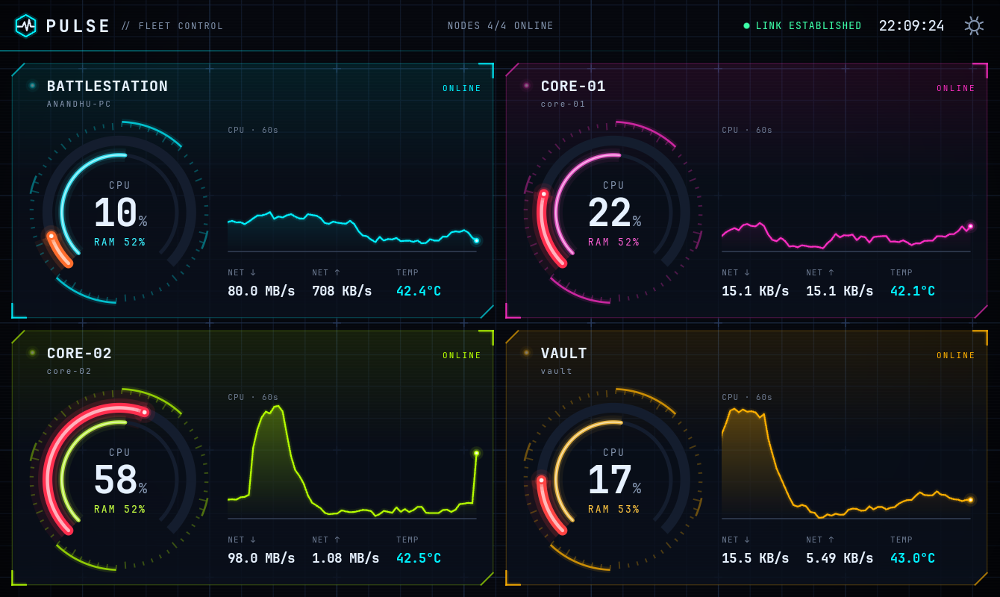
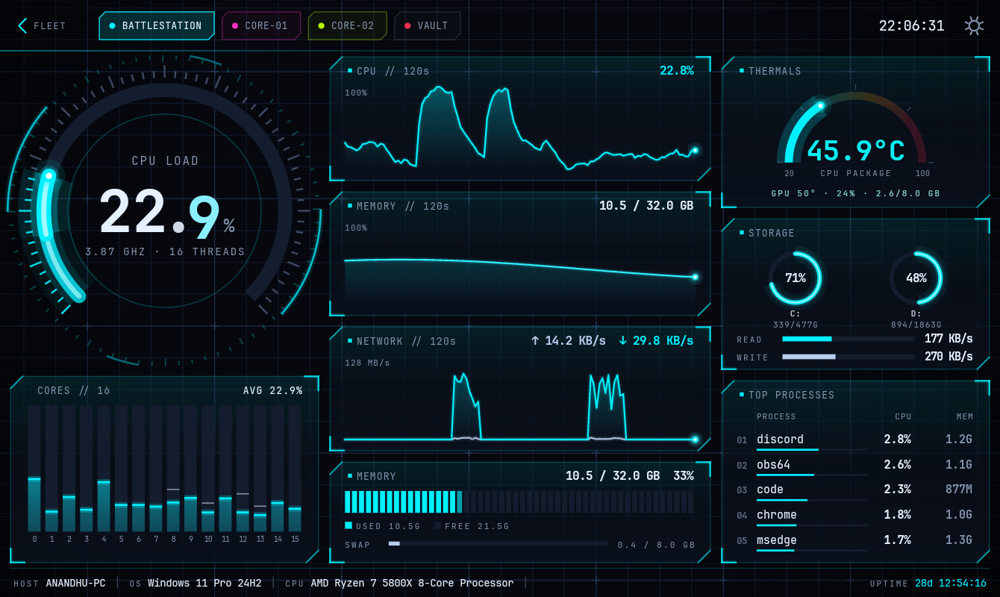
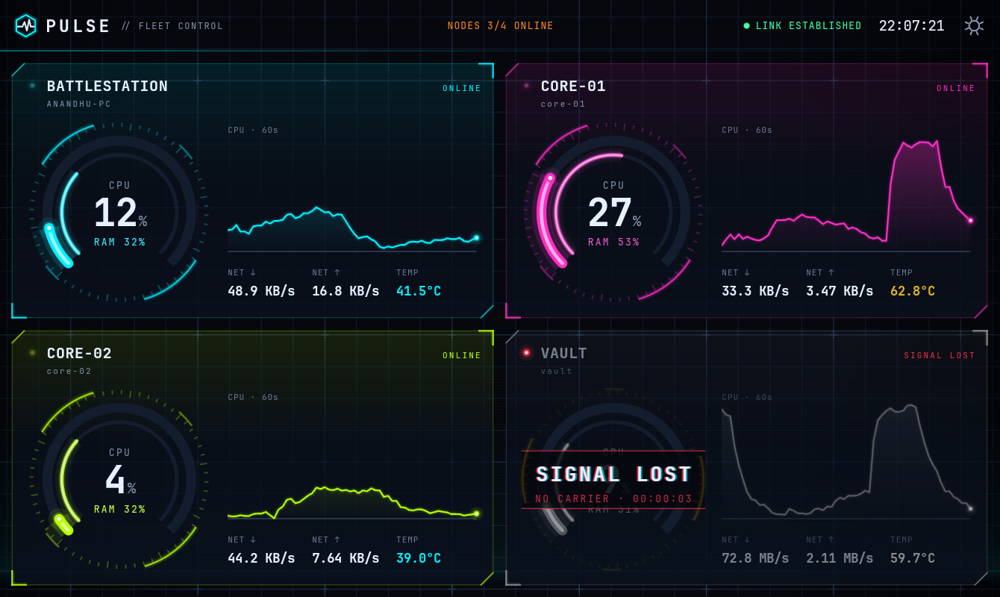
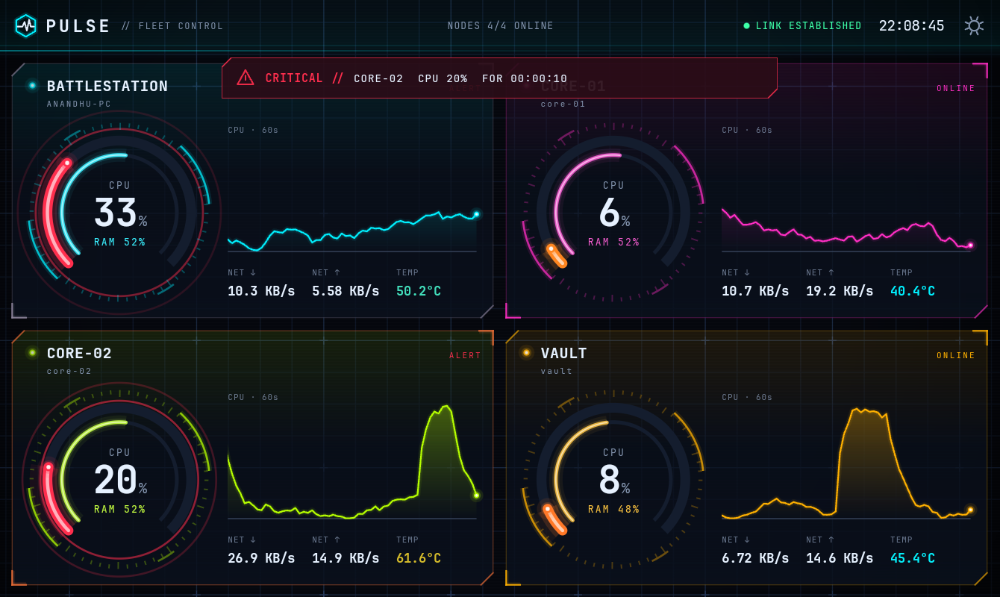

# PULSE: LAN system monitor with a sci-fi tablet console

[](LICENSE)
[](https://github.com/sponsors/Dr-At0mic)
[](https://www.buymeacoffee.com/anandhu.suresh)

Real-time CPU, RAM, disk, network, temperature, GPU and process telemetry from every machine
on your home LAN, streamed to a wall-mounted Android tablet that looks like a spaceship's
system console.

```
[agent: Windows PC] ──┐
[agent: Server 1]  ───┼──►  [hub on Server 1]  ══ one WebSocket ══►  [PULSE tablet app]
[agent: Server 2]  ───┘
```

| | |
|---|---|
|  |  |
| **Fleet overview.** One card per machine, neon accent per device. | **Detail.** Hero gauge with odometer digits, per-core equalizer, live graphs. |
|  |  |
| **SIGNAL LOST.** Desaturated card, RGB-split glitch text, live "no carrier" timer. | **Alert.** Threshold held for 5 s: red sweep, ripple rings, banner. |

More: [boot sequence](docs/screenshots/boot.png) · [card→detail zoom](docs/screenshots/zoom-transition.png) ·
[portrait](docs/screenshots/portrait-detail.png) · [hub down](docs/screenshots/hub-down.png) ·
[Linux detail with cached RAM + load average](docs/screenshots/detail-linux.png)

*(Screenshots are from the Android emulator at the Galaxy Tab A7 Lite's resolution,
1340×800 at 213 dpi, fed by `tools/mock_agent.py`.)*

---

## Contents

1. [What's in the box](#whats-in-the-box)
2. [Install the hub on the Ubuntu server](#1-install-the-hub-on-the-ubuntu-server)
3. [Install the agent](#2-install-the-agent) on [Ubuntu](#2a-ubuntu) and on [Windows](#2b-windows-dapplicationspulseagent)
4. [Build and sideload the tablet app](#3-build-and-sideload-the-tablet-app)
5. [Add a new device later](#4-add-a-new-device-later)
6. [Troubleshooting](#5-troubleshooting)
7. [Security](#security)
8. [Performance budgets: measured results](#performance-budgets-measured-results)
9. [Verify RAM and FPS on the tablet](#verify-the-ram-and-fps-budgets-on-the-tablet)
10. [Design decisions and trade-offs](#design-decisions-and-trade-offs)
11. [Development](#development)
12. [Contributing, licence and contact](#contributing-licence-and-contact)

---

## What's in the box

```bash
git clone https://github.com/Dr-At0mic/PULSE.git
```

```
PULSE/
  agent/      agent.py, config.yaml.example, install.sh, install.ps1, pulse-agent.service, tests/
  hub/        hub.py, config.yaml.example, install.sh, pulse-hub.service, tests/
  android/    Gradle project (Kotlin, plain framework Views, no AndroidX)
  tools/      mock_agent.py
  docs/       screenshots
  PROTOCOL.md full wire protocol
  README.md, CONTRIBUTING.md, LICENSE (GPL-3.0)
```

* **Agent** (Python 3.11+, `psutil`). Samples once per second and pushes to the hub. It is
  send-only: no listening ports, no commands accepted.
* **Hub** (Python, `websockets`). Keeps the latest snapshot and a 120-sample ring per device,
  detects silence, and fans out to the tablet in the mode the tablet asks for.
* **Tablet app** (Kotlin). Every gauge, graph and bar is a hand-drawn `Canvas` view, driven by
  one `Choreographer` loop. The single dependency is OkHttp.

---

## 1. Install the hub on the Ubuntu server

The hub runs on the always-on server (Server 1), so every agent and the tablet have one fixed
address to reach.

```bash
# on Server 1
git clone https://github.com/Dr-At0mic/PULSE.git
cd PULSE/hub
sudo ./install.sh
```

What the script does, and why:

| Step | Why |
|---|---|
| Creates a system user `pulse` with no shell | The hub never needs root, so a bug can't touch the rest of the box. |
| Installs to `/opt/pulse-hub` with a private venv | Python packages stay isolated from the system Python. |
| Generates a random token into `config.yaml` (mode 640) | Agents and the tablet must present it; the file is readable only by root and the hub. |
| Installs `pulse-hub.service` with `Restart=always` and systemd sandboxing | It survives crashes and reboots. `ProtectSystem=strict`, an empty capability set and `MemoryMax=80M` limit what it could ever do. |

Then **edit `/opt/pulse-hub/config.yaml` and set `host` to the server's LAN IP** (for example
`192.168.1.10`). Binding to the LAN address instead of `0.0.0.0` means the hub is never
reachable on Docker bridges, VPN interfaces or a second NIC.

```bash
sudo systemctl restart pulse-hub
curl http://192.168.1.10:8765/health
# {"ok":true,"devices":0,"online":0,"clients":0,"uptime":3}
```

Open the firewall to the LAN only (see [Security](#security)):

```bash
sudo ufw allow from 192.168.1.0/24 to any port 8765 proto tcp comment 'PULSE hub (LAN only)'
```

## 2. Install the agent

Every machine you want on the dashboard gets an agent, including Server 1 itself.

### 2a. Ubuntu

```bash
cd PULSE/agent
sudo ./install.sh ws://192.168.1.10:8765 <token> srv1 CORE-01 "#FF2EC4"
#                 hub URL                 token   id   name    accent
```

| Step | Why |
|---|---|
| Installs to `/opt/pulse-agent`, runs as the unprivileged user `pulse-agent` | `/proc`, `/sys` (temperatures, disks) and psutil all work without root. |
| `Restart=always`, `Nice=10`, `CPUQuota=10%`, `MemoryMax=60M` | The agent comes back after crashes, always yields to real work, and can never run away. |
| `ProtectSystem=strict`, `ProtectHome=read-only`, no capabilities | It reads stats and opens one outbound socket. Nothing else is allowed. |

Check it: `journalctl -u pulse-agent -f` should show `connected to ws://.../agent`.

### 2b. Windows (`D:\Applications\PulseAgent`)

Requirements: Python 3.11 or newer. If you want *nothing* on C:, install Python itself to
`D:\Applications\Python313` (choose "Customize installation" in the installer).

**One click:** right-click `agent\install.ps1` → *Run with PowerShell*. It elevates itself,
asks for the hub URL, token, id and name, and does everything else. Or non-interactively:

```powershell
powershell -ExecutionPolicy Bypass -File agent\install.ps1 -HubUrl ws://192.168.1.10:8765 -Token <token> -Id pc -Name BATTLESTATION -Accent "#00F0FF"
```

What it does, and why:

| Step | Why |
|---|---|
| Refuses to install on `C:` | As requested. Everything lives in `D:\Applications\PulseAgent`. |
| `pip install --target D:\Applications\PulseAgent\lib --no-cache-dir` | Packages go next to the agent, not into your Python install. `--no-cache-dir` keeps pip from writing its cache to `C:\Users\...`. |
| Locks `config.yaml` to Administrators + SYSTEM | The token isn't readable by other users. |
| Runs `agent.py --print` once | Fails fast with a readable error instead of a silent service. |
| Registers background start-up (below) | Runs at boot with no console window. |

**Option A: Windows service via NSSM (recommended).** Download `nssm.exe` from
<https://nssm.cc/download> and put it in `D:\Applications\PulseAgent` (or on `PATH`) before
running the script. NSSM gives you a real service: auto-restart after 2 s, delayed
auto-start, below-normal priority, and rotating logs in `D:\Applications\PulseAgent\logs`.

```powershell
Get-Service PulseAgent
Restart-Service PulseAgent
```

**Option B: Task Scheduler (no extra download).** `install.ps1 -Mode Task`, or automatic
when NSSM isn't found. It creates a task that runs `pythonw.exe` (no window) as SYSTEM at
startup (30 s delay), restarts on failure, and has no time limit. Logs go to
`D:\Applications\PulseAgent\logs\agent.log`.

```powershell
Get-ScheduledTask PulseAgent | Get-ScheduledTaskInfo
```

Uninstall either one with `install.ps1 -Uninstall`.

**CPU temperature on Windows (optional).** psutil can't read temperatures on Windows, so the
agent sends `null` and the tablet shows `N/A`. To get a reading, run
[LibreHardwareMonitor](https://github.com/LibreHardwareMonitor/LibreHardwareMonitor), enable
*Options → Remote Web Server → Run* (port 8085), and uncomment
`lhm_url: http://127.0.0.1:8085/data.json` in `config.yaml`. I read its local JSON endpoint
instead of its WMI provider: one HTTP request every 3 s is much cheaper than COM/WMI queries
and needs no `pywin32`.

## 3. Build and sideload the tablet app

You need JDK 17 or newer and the Android SDK (Android Studio installs both).

```bash
cd PULSE/android
./gradlew assembleRelease            # Windows: gradlew.bat assembleRelease
# -> app/build/outputs/apk/release/app-release.apk   (~470 KB)
```

Why release: R8 shrinks and optimises the code (APK ~470 KB versus the 8 MB budget). The
release build is signed with the debug key so you can sideload it immediately. Use your own
keystore if you ever distribute it.

Sideload over USB:

1. On the tablet: *Settings → About tablet → Software information*, tap **Build number** 7
   times, then enable *Developer options → USB debugging*.
2. Connect it and accept the RSA prompt.
3. `adb install -r app/build/outputs/apk/release/app-release.apk`

First launch: the boot sequence finds no hub and opens **Settings**. Enter the hub address
(`192.168.1.10:8765`) and the `client_token`, then tap **SAVE & CONNECT**. The status line
turns green: `LINK ESTABLISHED · N NODES`.

Wall-mount tips: keep **KEEP SCREEN ON** enabled (default); the app hides the system bars
(immersive mode) by itself. Use **LOW-POWER MODE** when running on battery. The app
disconnects whenever the screen turns off or it goes to the background, and reconnects when
you come back.

## 4. Add a new device later

Nothing changes on the hub or the tablet. Install the agent on the new machine with a new id:

```bash
sudo ./install.sh ws://192.168.1.10:8765 <token> srv2 CORE-02 "#B6FF00"
```

The hub learns about a device from its first `i` (info) frame, and the tablet creates a card
for it the moment it appears. The grid re-flows automatically (3 devices: one row of three
in landscape; 4: a 2×2 grid). You can override its accent on the tablet under
*Settings → Device accents*.

## 5. Troubleshooting

| Symptom | Cause / fix |
|---|---|
| Tablet: `AUTH REJECTED` | The tablet token doesn't match `client_token` in the hub config. The hub logs `rejected client ... bad token`. |
| Tablet: `LINK DOWN · RETRYING` | Hub not reachable. Check `curl http://HUB:8765/health` from another machine, check that `host:` in the hub config is the LAN IP, and check `sudo ufw status`. The tablet retries with backoff (1 s → 30 s). |
| A card says `SIGNAL LOST` | The hub hasn't heard from that agent for 4.5 s. Ubuntu: `journalctl -u pulse-agent -n 50`. Windows: `D:\Applications\PulseAgent\logs\`. |
| Agent log: `HTTP 401 (wrong token?)` | `token:` in the agent config must equal `agent_token` in the hub config. |
| Agent log: `hub unreachable: timed out` | Wrong `hub_url`, hub down, or firewall. Agents retry with backoff (1 s → 30 s). |
| Temperature shows `N/A` | Windows without LibreHardwareMonitor (see 2b), or a Linux box without a `coretemp`/`k10temp` driver: run `sensors` (`lm-sensors`). |
| No GPU line | Only NVIDIA is supported, via `nvidia-smi` on `PATH` (it is on Windows by default). |
| Network rates look wrong | Virtual NICs (Docker, WSL, VMware, VPNs) are excluded by name. `python agent.py --print` shows exactly what is sent. |
| Two machines fight over one card | They share the same `id`. Ids must be unique. |
| Hub log: `dropping agent ... protocol error` | The first frame wasn't a valid `i`, or the frame was malformed JSON. Check the agent version. |

---

## Security

PULSE is designed for a trusted home LAN and assumes nothing beyond that.

* **LAN only.** The hub binds to the server's LAN IP. Firewall it to your subnet:
  ```bash
  sudo ufw default deny incoming
  sudo ufw allow from 192.168.1.0/24 to any port 22   proto tcp comment 'SSH'          # keep your SSH
  sudo ufw allow from 192.168.1.0/24 to any port 8765 proto tcp comment 'PULSE hub'
  sudo ufw enable
  ```
  Agents need **no inbound rules at all**. On Windows, outbound traffic is allowed by default.
  If you run a default-deny outbound policy, allow only the agent's Python to reach the hub:
  ```powershell
  New-NetFirewallRule -DisplayName "PULSE agent -> hub" -Direction Outbound -Action Allow `
    -Program "D:\Applications\Python313\python.exe" -RemoteAddress 192.168.1.10 -Protocol TCP -RemotePort 8765
  ```
  (Use the Python path that `install.ps1` printed; add `pythonw.exe` too in Task mode.)
* **Shared-token authentication on both endpoints**, sent as `Authorization: Bearer`. A
  wrong token is rejected with HTTP 401 during the handshake, before any WebSocket frame is
  exchanged. Tokens are compared in constant time (`hmac.compare_digest`). Agents and the
  tablet can have different tokens (`agent_token`, `client_token`).
* **Agents are send-only.** They open no ports and the hub never sends them anything but
  WebSocket pings. There is no command channel: nobody can run anything on your machines
  through PULSE.
* **An agent can only report for its own id.** Frames carrying a different id are dropped.
  Frames are limited to 64 KiB, devices to 32 and clients to 8.
* **The traffic is plain `ws://`.** It is unencrypted inside your LAN, which is a deliberate
  choice: TLS would need certificates on every device for little gain on a home network. If
  your LAN isn't trusted, terminate TLS in front of the hub (Caddy or nginx) and use `wss://`
  URLs; both the agent and the app accept them.

---

## Performance budgets: measured results

All numbers below were measured, not estimated. "One core" means 100% = one fully busy logical
core; Windows Task Manager shows the share of the whole machine instead.

| Budget | Result | How it was measured |
|---|---|---|
| Agent < 0.5% CPU | **0.26% of one core** (0.011% of the machine) with GPU sampling off; **0.49% of one core** with `gpu: smi`, plus ~1.1% of one core inside the short-lived `nvidia-smi` helper | Windows 11, Ryzen 9 9900X (24 threads), 352 processes, agent connected and streaming, 60 s window after warm-up |
| Agent < 40 MB RAM | **26.5 MB private working set** (what Task Manager shows), flat over 4 min; 44 MB RSS, which includes shared Windows system DLLs | same |
| Agent on Linux | **0.17% of one core, 29.6 MB RSS / 18.5 MB private**, with `gpu: smi` | Ubuntu 24.04 (WSL2) on the same PC, 30 s window, connected to a local hub |
| Hub < 50 MB RAM | **17.5 MB private / 28 MB RSS** with 4 agents and 2 clients | same |
| Tablet ≤ 70 MB PSS | ✓ **50 MB** on a fresh start (overview). ✗ **82–87 MB** after the detail screen has been opened, because the PowerVR driver and Skia keep their peak allocations (see below). Java heap stays at 2–5 MB. | Real Galaxy Tab A7 Lite (Helio P22T, Android 14 TrebleDroid), `dumpsys meminfo`. Earlier emulator soak: flat at ≈ 51 MB over 36 min |
| 60 fps | Detail screen **≈ 58 fps, 4 % janky frames**; overview ≈ 56 fps, 5–8 % janky. Was 40 fps and 48 % janky before the tablet-specific fixes. | Real tablet, `dumpsys gfxinfo`, 30 s windows, app AOT-compiled |
| APK < 8 MB | **467 KB** | release build with R8 |
| Sample → tablet < 1.5 s | **~35 ms** hub delivery (±50 ms because `ts` is rounded to 0.1 s), plus one frame of drawing. Values start animating immediately; graphs glide toward the new sample over one sample interval. | client-side `now - ts` over 54 frames |
| SIGNAL LOST within 5 s | Silent (unplugged) device: **4.5–4.75 s**. Stopped agent: **immediately** (socket close). | hub log + unit tests |

**What the real tablet taught us.** The emulator predicted neither the frame rate nor the
memory. On the Helio P22T the GPU kept up (10–15 ms per frame), but the CPU did not: per-frame
timestamps (`gfxinfo framestats`) showed the RenderThread spending 16–32 ms re-issuing the
detail screen's glowing paths on every frame. The fixes, all without changing the look:

* Graphs and sparklines are recorded **once per sample** into a small GPU texture and slid
  with `translationX`; the leading dot moves with `translationY` (`ScrollingPlot`).
* Only the views with genuinely expensive drawing (hero gauge, thermals, storage, graph
  panels) get their own hardware layer, so they're re-rendered only when their values change.
* Fades no longer allocate full-size offscreen buffers (`hasOverlappingRendering = false`).
* The background grid is a 118 KB repeating tile instead of a 5 MB full-screen layer.
* Dashed gridlines are precomputed segments (a `DashPathEffect` is re-applied on every frame
  replay), and the core-bar peak markers stop falling once the bars settle.

**Known gap: memory after the detail screen.** Native heap grows from ~15–24 MB to ~40 MB and
stays there: the PowerVR driver and Skia's software path masks allocate in the app's heap,
and that peak is never returned. Skia also keeps dropped layers in a "purgeable" pool that
apps can't force it to free. Remaining options, each with a trade-off: simplify the glow on
graph lines from 3 strokes to 2, or fully release the detail screen when you leave it (it
reopens a little slower). The tablet has plenty of free RAM, so this doesn't affect
stability. On battery, **Low-power mode** removes all ambient motion and caps rendering at
30 fps.

Why the agent is this cheap on Windows: psutil's per-process calls cost **334 ms of CPU per
scan** of 352 processes (it falls back to a full system snapshot for each process that
denies access). The agent instead takes **one** `NtQuerySystemInformation` snapshot (2.3 ms).
Likewise it reads only the real NICs via `GetIfEntry2` instead of enumerating every
pseudo-interface (2 ms → < 0.02 ms), and it reads swap every 30 s instead of every second
(the PDH counter costs ~30 ms per call). The struct offsets were checked byte-for-byte
against psutil on the same machine.

## Verify the RAM and FPS budgets on the tablet

Connect the tablet with `adb` (step 3), launch PULSE, and let it run.

**RAM (≤ 70 MB PSS, must stay flat):**

```bash
adb shell dumpsys meminfo io.pulse.hud | grep -E "TOTAL PSS|Java Heap|Native Heap"
```

Run it at start, after 10 minutes and after 1 hour. A flat Java heap with a PSS that levels
off is healthy: HWUI's glyph and path caches warm up during the first few minutes. A sketch
of a one-hour soak log:

```bash
for i in $(seq 0 12); do adb shell dumpsys meminfo io.pulse.hud | grep "TOTAL PSS"; sleep 300; done
```

**FPS (60, no dropped frames):**

1. *Developer options → Profile HWUI rendering → On screen as bars.* Each bar is a frame. The
   green line is 16 ms; bars should stay under it. Open the detail screen too, since it's the
   heaviest (three graphs scroll continuously).
2. For numbers:
   ```bash
   adb shell dumpsys gfxinfo io.pulse.hud reset
   # use the app for 60 s
   adb shell dumpsys gfxinfo io.pulse.hud | grep -E "Total frames|Janky|percentile|Slow UI"
   ```
   Look for `Janky frames` under ~1% and `Number Slow UI thread: 0`. Note that the overview
   deliberately renders at 30 fps when only ambient motion is running (see below), and that
   is not jank.
3. Overdraw: *Developer options → Debug GPU overdraw.* The background should be at most
   light blue (1×) and cards green (2×).

**CPU:** `adb shell top -H -p $(adb shell pidof io.pulse.hud)` shows the main thread (my
drawing and animation) and `RenderThread` (GPU submission) separately.

---

## Design decisions and trade-offs

The brief asked me to say when a visual idea would break a budget and to propose an
equivalent instead of silently dropping it. These are the calls I made:

| Idea | Problem | What I did instead |
|---|---|---|
| Glassmorphism (frosted panels) | Backdrop blur every frame is far too slow on a PowerVR GE8320 | **Faux glass**: an accent-tinted vertical gradient, a hairline border, bright corner brackets and a chamfer highlight. It reads as a glass plate on a dark void for the cost of one gradient fill. |
| Neon glow (`BlurMaskFilter`) | Real-time blur is expensive and forces software layers | **Four strokes**: a faint wide halo (7%), a brighter mid halo (16%), the coloured core and a near-white filament, approximating a light falloff. Arcs use butt caps so their starts don't form blobs. |
| Drifting grid, rotating rings, breathing dots | Redrawing them each frame costs CPU on every vsync | They're **separate Views drawn once into hardware layers** (GPU textures) and animated only through RenderNode properties (`translation`, `rotation`, `alpha`). `onDraw` never runs for them again; a frame of ambient motion costs a few float writes. Ambient-only frames run at **30 fps**, and the loop stops entirely when nothing moves. |
| One animator per widget | Dozens of callbacks and wakeups | **One `Choreographer` callback for the activity.** Widgets report idle / ambient / active and the driver chooses 0, 30 or 60 fps. |
| Shared-element zoom | Snapshot bitmaps cost memory and upload time | An overlay draws an **expanding HUD frame** from the card's bounds to the screen while the card's CPU ring **flies and scales into the hero gauge's position**, then the detail panels fade in with their own entrance animations. No bitmaps. |
| "SIGNAL LOST" glitch | Slicing a card is costly if it runs constantly | Only offline cards glitch, in **240 ms bursts every 2–4 s** (5 clipped slices with random offsets plus RGB-split text). Between bursts the card is static. Low-power mode disables the bursts. |
| Scrolling graphs | Time-based scrolling would need allocations and jitters with network timing | Index-based scrolling: the newest point enters one step off-screen and slides in over the **measured** sample interval, while the leading dot interpolates between the last two samples. |
| Counter roll | `String.format` allocates on every frame | A hand-written **odometer**: digit wheels clipped and scrolled with true carry (a higher wheel only turns while every lower digit rolls 9→0), drawn from `char[]`. |
| GPU stats via NVML | NVIDIA's driver DLL adds **~23 MB** to the agent (56 MB RSS) | Default `gpu: smi`: a one-shot `nvidia-smi` every `gpu_interval` seconds (2). NVML stays available as `gpu: nvml` if you prefer RAM over CPU. |
| Offline after 5 s | The last sample before an unplug is already ~0.5 s old, so a 5 s timeout lands around 5.3 s | **4.5 s timeout**, so the "within 5 s" acceptance holds. Configurable. |
| Two typefaces (the design search suggested Orbitron + JetBrains Mono) | The brief allows one family; every font costs APK size and memory | **JetBrains Mono only** (Regular + Bold, OFL). Monospaced digits never jitter. |
| AndroidX / Fragments / Compose | Tens of MB of RAM and APK | Plain `Activity` and framework Views. The only dependency is OkHttp; JSON uses `org.json`. |

The rules I held to in the app:

* **Zero allocations in `onDraw()`**: every `Paint`, `Path`, `RectF` and shader is
  pre-allocated, text goes through `char[]` buffers (`Fmt`), and loops are index-based (no
  iterators). Shaders are rebuilt only on size or accent changes.
* **Fixed memory**: history lives in 120-point `FloatArray` rings; a unit test pushes 10,000
  samples and checks the capacity holds.
* **Interpolate everything**: 500–600 ms ease-out for gauges, damped springs for core bars and
  process rows, so 1 Hz data feels continuous.
* **Contrast**: labels on the void measure ~6.4:1 and body text ~17:1; colour never carries
  meaning alone (states also have text: ONLINE / ALERT / SIGNAL LOST). Touch targets are at
  least 44 dp.

---

## Development

Run everything on one machine without real agents:

```bash
python -m venv .venv && .venv/bin/pip install websockets psutil pyyaml pytest
PULSE_AGENT_TOKEN=devtoken123 python hub/hub.py -c none.yaml       # hub on :8765, token from env
python tools/mock_agent.py --token devtoken123 --devices 4          # 4 fake machines
```

The mock produces idle stretches, normal load, CPU spikes long enough to trigger alerts,
network and disk bursts, temperatures that lag the load, process lists that reorder, and a
device that drops out every ~70 s, alternating between a **silent socket** (unplugged cable)
and a **closed socket** (agent stopped), so both offline paths get exercised. Options:
`--offline-every`, `--offline-for`, `--no-outages`, `--seed`.

In the Android emulator the host machine is `10.0.2.2`, so set the hub to `10.0.2.2:8765`.

Tests:

```bash
python -m pytest agent/tests hub/tests     # rate calculations, NIC/disk filters, temps; offline detection, fan-out, history
cd android && ./gradlew testReleaseUnitTest  # ring buffer, formatter, easing/spring
```

Diagnostics: `python agent/agent.py -c config.yaml --print` prints exactly what the agent
would send, once.

The wire protocol is documented in [PROTOCOL.md](PROTOCOL.md).

---

## Contributing, licence and contact

**Contributing:** bug reports, ideas and pull requests are welcome. See
[CONTRIBUTING.md](CONTRIBUTING.md) for how to set up, test and submit changes.

**Licence:** PULSE is free software, released under the **GNU General Public License v3.0
or later** ([LICENSE](LICENSE)).

```
PULSE - LAN system monitor with a sci-fi tablet console
Copyright (C) 2026 Anandhu Suresh

This program is free software: you can redistribute it and/or modify it under the terms of
the GNU General Public License as published by the Free Software Foundation, either version 3
of the License, or (at your option) any later version.

This program is distributed in the hope that it will be useful, but WITHOUT ANY WARRANTY;
without even the implied warranty of MERCHANTABILITY or FITNESS FOR A PARTICULAR PURPOSE.
See the GNU General Public License for more details.
```

Third-party components keep their own licences: JetBrains Mono is © The JetBrains Mono
Project Authors under the SIL Open Font License 1.1
([LICENSES/JetBrainsMono-OFL.txt](LICENSES/JetBrainsMono-OFL.txt)); OkHttp is Apache 2.0.

**Contact:** Anandhu Suresh · [anandhu2suresh797@gmail.com](mailto:anandhu2suresh797@gmail.com) ·
GitHub [@Dr-At0mic](https://github.com/Dr-At0mic). For bugs and feature requests, please
[open an issue](https://github.com/Dr-At0mic/PULSE/issues) so others can find the answer too.

**Support the project:** if PULSE is useful to you, you can
[sponsor on GitHub](https://github.com/sponsors/Dr-At0mic) or
[buy me a coffee](https://www.buymeacoffee.com/anandhu.suresh).
